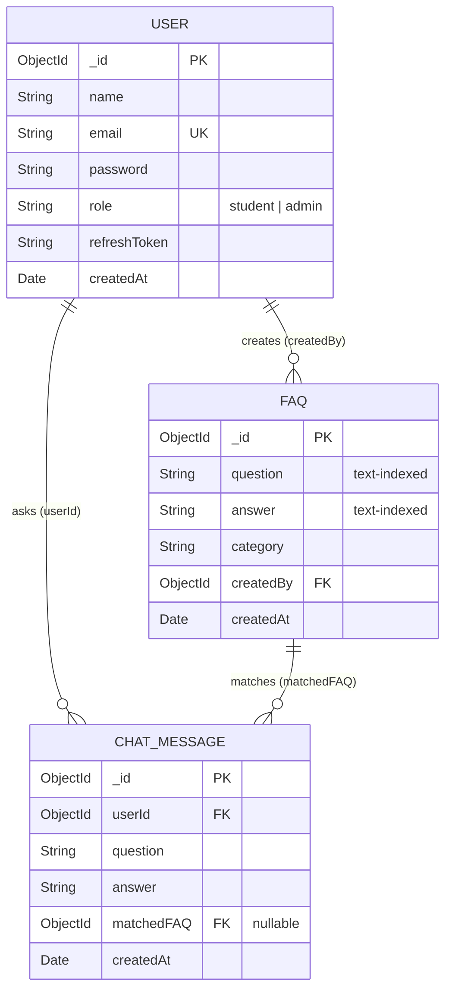

# AskCampus Database Schema & ER Diagram

AskCampus uses MongoDB with Mongoose ODM and three primary collections: `users`, `faqs`, and `chatmessages`.

## Entity-Relationship (ER) Diagram

## Collection Details

### 1. `users` (`User` model)
- **`name`**: `String`, required, 2–80 characters.
- **`email`**: `String`, required, unique, lowercase, validated email format.
- **`password`**: `String`, required, minimum 6 characters, hashed with `bcryptjs` before save, `select: false`.
- **`role`**: `String`, enum `['student', 'admin']`, default `'student'`.
- **`refreshToken`**: `String`, `select: false`, stores the active JWT refresh token.
- **`createdAt`**: `Date`, default `Date.now`.

### 2. `faqs` (`FAQ` model)
- **`question`**: `String`, required, minimum 5 characters.
- **`answer`**: `String`, required, minimum 5 characters.
- **`category`**: `String`, required, enum:
  `Admissions`, `Fees and Scholarships`, `Examinations`, `Attendance`, `Timetables`, `Placements`, `Campus Facilities`, `Events`.
- **`createdBy`**: `ObjectId` referencing `User`, required.
- **`createdAt`**: `Date`, default `Date.now`.
- **Indexes**:
  - Text index on `{ question: 'text', answer: 'text' }` for MongoDB full-text search.

### 3. `chatmessages` (`ChatMessage` model)
- **`userId`**: `ObjectId` referencing `User`, required.
- **`question`**: `String`, required.
- **`answer`**: `String`, required.
- **`matchedFAQ`**: `ObjectId` referencing `FAQ`, default `null` (when `null`, the question is tracked as unanswered in Admin Reports).
- **`createdAt`**: `Date`, default `Date.now`.
- **Indexes**:
  - Compound index on `{ userId: 1, createdAt: -1 }` for fast per-student chat history queries.
